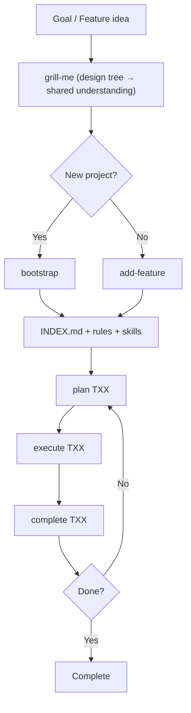
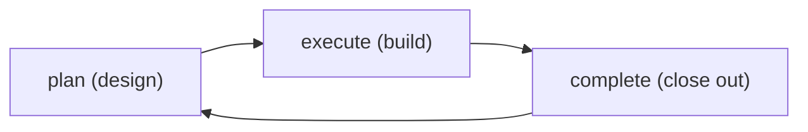

# 🧠 Praxis methodology

  

## 🔥 The problem

Long-horizon projects fail with coding agents when:

- Rules describe a **different product** than the one being built (stale fork residue)
- Work is one giant prompt instead of **ordered, verifiable layers**
- There is no **close-out ritual** (learnings → rules, INDEX update, downstream sync)

Praxis is a portable operating system for agents: adapt rules to the goal,
slice the goal into phases, and loop plan → execute → complete until done.

---

## 🚪 Two entry points

Every idea is grilled first — `/praxis:grill-me` is the universal front-door. It is
most valuable on greenfield work, where nothing exists yet and every unspoken
assumption is still on the table.

| When                               | Use                    | What it does                                                                                                              |
| ---------------------------------- | ---------------------- | ------------------------------------------------------------------------------------------------------------------------- |
| **New project** (greenfield)       | `/praxis:grill-me` → `/praxis:bootstrap` | `/praxis:grill-me` stress-tests the idea to a settled shared understanding; `/praxis:bootstrap` adapts rules, creates layered phases, ships verify gate, writes README — a **ready-to-build MVP** |
| **New feature** (existing project) | `/praxis:grill-me` → `/praxis:add-feature` | `/praxis:grill-me` stress-tests the idea to a settled shared understanding; `/praxis:add-feature` turns it into new phase stubs without disturbing existing infrastructure |

---

## 🏛️ Three pillars

### 1. 🧭 Agent rules (hub → spoke)

One always-on hub routes agents to domain-specific spokes. No duplicated rules trees.

| Layer              | Location                     | Role                                                                                           |
| ------------------ | ---------------------------- | ---------------------------------------------------------------------------------------------- |
| Hub (always on)    | `.claude/rules/general.md`   | Karpathy guidelines, routing, safety, rule maintenance, product architecture, skills inventory |
| Spokes (on demand) | `.claude/rules/<domain>.md`  | Failure modes and conventions for one domain (API, UI, packaging, dependency docs, …)          |
| Skills (commands)  | plugin `skills/*/SKILL.md`| Procedures: grill-me, bootstrap, add-feature, plan, execute, complete, dialectic, audit           |

- Skills and subagents ship in the plugin (`/praxis:*`); Claude Code auto-loads `.claude/rules/general.md`
  (no `paths:` frontmatter) at session start, and auto-loads each `.claude/rules/<domain>.md`
  spoke whenever a file matching its `paths:` frontmatter is read or edited — its native
  path-scoped rules mechanism
- **Never** duplicate rules outside `.claude/rules/`
- Bootstrap adapts rules to the specific product — deletes inapplicable spokes, creates new ones for named dependencies

### 2. 📋 Layered phases

Tasks are ordered by dependency so each layer is verifiable before the next begins.

**`planning/phases/INDEX.md`** is the single source of truth:

| Column     | Meaning                                                |
| ---------- | ------------------------------------------------------ |
| ID         | `T01` … `Tnn`                                          |
| Title      | Short name + link to stub file                         |
| Status     | `Pending` → `Planned` → `InProgress` → `✅` / `Blocked` |
| Depends-on | Prior task IDs or `—`                                  |
| Next       | Following task ID                                      |
| Layer      | Which capability layer this advances                   |

**T01** is always the skeleton bootstrap — minimal runnable program + verify gate passing.
No business logic, just the scaffold that compiles and tests green.

**Each stub file** (`TXX-name.md`) has: Description, Requirements, Acceptance Criteria,
empty Execution plan (filled by `/praxis:plan`), Test Plan, Verification, Files Modified.

### 3. 🔁 Work loop skills

| Skill                     | When                            | Recommended model                                                         | Does                                                                              |
| ------------------------- | ------------------------------- | ------------------------------------------------------------------------- | --------------------------------------------------------------------------------- |
| `/praxis:grill-me`               | Before `/praxis:bootstrap` or `/praxis:add-feature` | Large                                                                     | Design-tree interview in rounds until shared understanding; facts via sub-agents |
| `/praxis:bootstrap`    | New project                     | Large                                                                     | Goal → rules + phases + README + verify gate                                      |
| `/praxis:add-feature`            | New feature in existing project | Large                                                                     | Context → new phase stubs appended to INDEX                                       |
| `/praxis:plan TXX`        | Before coding                   | Medium (large only for complex tasks)                                     | Reality-check; handoff-ready plan for execute agent                               |
| `/praxis:execute TXX`     | After plan                      | Medium or small                                                           | Follow plan until AC pass; run the verify command; do not mark INDEX ✅          |
| `/praxis:complete TXX`    | After execute                   | Medium or small                                                           | Re-verify; dialectic; INDEX → ✅; commit; push (default); Manual test; next branch |
| `/praxis:learn` | End of hard sessions            | —                                                                         | Particular → general → encode into spokes                                         |
| `/praxis:audit-rules`            | Periodically                    | —                                                                         | Read-only audit of rules/skills vs tree                                           |
| `/praxis:status`                 | Returning to a project          | Small                                                                     | Read-only progress report; offers the next command as a button                    |

> 💡 See [README: Skills](README.md#-skills) for which
> specific provider/models correspond to each size tier. These are **recommendations,**
> not hard rules — use the best model you have access to for the task's complexity budget.

### 4. 🤖 Subagent delegation

Every skill delegates facts-gathering and mechanical work to **subagents** instead
of doing it serially on the parent. The parent keeps decisions, design, and
human interaction. Subagents are invoked via the `Agent` tool by name — e.g.
`Agent(explorer)` — against the concrete roster defined at `.claude/agents/*.md`
(shipped in the plugin's `agents/`). Model sizing (large/medium/small) is
still a **class, not a specific alias** — see [Model recommendations](README.md#-skills).

**Delegation routing:**

| Subagent (plugin `agents/`)      | Purpose                                                                 | Used by                                    |
| --------------------------------- | ------------------------------------------------------------------------ | ------------------------------------------- |
| `explorer`                        | Find files, read code, trace calls, map architecture, verify facts       | grill-me, add-feature, bootstrap, plan      |
| `web-researcher`                  | Fetch docs, check API references                                         | bootstrap (dep spokes), grill-me, plan      |
| `implementer`                     | Well-scoped feature/bugfix from a clear spec                             | execute (bounded subtasks)                  |
| `refactorer`                      | Extract/rename/move — behavior-preserving changes                        | execute                                     |
| `test-runner`                     | Run tests, diagnose failures                                             | execute, complete (background)              |
| `code-reviewer`                   | Correctness/lint/style/bug review of a diff                              | after execute and after dialectic edits     |
| `verifier`                        | Skeptical independent check that claimed work is actually done           | after execute (background)                  |
| `plan-reviewer`                   | Cold-read check that a plan needs no guessing                            | plan (before `Planned`)                     |
| `doc-writer`                      | Docs/changelog/README updates from diffs                                 | complete, dialectic                         |

Ad hoc multi-step shell work (a one-off grep, a build command) stays on the
parent's own `Bash` tool directly — it isn't delegated to a subagent.

**Rules:**

- **Facts are the subagents' job; decisions and design are the parent's.**
- **Parallelize independent work** — one subagent per independent area in a
  single batch. Don't block on a running subagent: ask what's unblocked now.
- **Background post-edit checks:** after non-trivial edits, launch
  `Agent(code-reviewer)` and `Agent(test-runner)` in the background and
  continue; fold results in when they report.
- **Escalate on bad output:** if a subagent returns incomplete/nonsensical
  results, re-launch with tighter instructions or do it on the parent. Never
  accept silently.
- **Small tasks stay inline.** A single grep or one-file read is cheaper on the
  parent than a subagent round-trip. Over-splitting negates the win.
- A skill's `allowed-tools` frontmatter lists exactly which `Agent(...)` names
  it may invoke — extend that list (and add the corresponding file under
  `.claude/agents/`) before a skill can delegate to a new role.

---

## 🧠 Context gathering

Both `/praxis:bootstrap` and `/praxis:add-feature` share the same context-gathering pattern.
Before building anything, the agent must extract:

1. **Goal** — what users get when done (end-user perspective, 1–3 paragraphs)
2. **Technical scope** — language, runtime, OS targets, packaging, architecture
3. **Non-goals** — explicit exclusions that prevent scope creep
4. **Dependencies** — named libraries, frameworks, external APIs (each becomes a rules spoke)
5. **References** — code or docs to study (reimplement, don't vendor)

The agent **refuses to proceed** without clear answers. A vague one-liner means the
human hasn't thought it through yet.

---

## 🔥 Grilling (before planning — for any idea)

`/praxis:grill-me` is the interrogator that runs **first** — before
`/praxis:bootstrap` for a new project, or before `/praxis:add-feature` for a new
feature. It converts a rough idea into a **settled design tree** so the
planning skill starts from shared understanding instead of guesses. It pays off
everywhere, but is most valuable on **greenfield / brand-new projects**, where
nothing exists yet and every unspoken assumption is still open.

**Design tree:** every decision branches into the decisions that hang off it.
The session works the tree in **rounds**. The **frontier** is every decision
whose prerequisites are already settled — asked in one numbered round, each
question with a recommended answer (➡️). Silence = accept the recommendation.
Answers reshape the tree; the frontier is recomputed each round.

**Facts vs decisions:**

- **Facts are the agent's job** — schema, file paths, library capabilities,
  existing behavior. Dispatched to sub-agents, never asked of the human. A
  running exploration is just an unsettled prerequisite: only downstream
  questions wait for it.
- **Decisions are the human's** — every one is put to them and waited on.

**Done** = frontier empty: every branch visited, nothing silently assumed. The
agent then emits a **shared-understanding summary** (numbered, grouped by area,
with concrete specifics) and waits for the human's confirmation. Only then does
`/praxis:add-feature` run — every settled decision must land in the INDEX header and
task stubs, nothing assumed.

---

## 🔁 Running the loop

After bootstrap or `/praxis:add-feature` produces tasks, the work loop is (see
[README: Skills](README.md#-skills) for which
specific providers/models correspond to each size tier — these are recommendations):

1. **Plan** (`/praxis:plan TXX`): medium by default; switch to large only for complex
   tasks. Plan must be detailed enough that a lesser agent can execute without
   redesigning — paths, verify steps, tests, commands, pitfalls.

2. **Execute** (`/praxis:execute TXX`): medium or small. If the plan is thorough,
   medium is usually sufficient. Follow the plan exactly. Run the project's verify command.
   Hard-abort if it fails.

3. **Complete** (`/praxis:complete TXX`): medium or small. The harder the execution
   was, the more dialectic learning to apply — medium when substantial patterns were
   learned, small for routine close-outs. Re-verify, run dialectic of cognition,
   mark INDEX ✅, commit, push (default; `--no-push` to skip), emit Manual test
   section, switch to next stub-stem branch.

- One task InProgress at a time unless the human says otherwise
- Work on `<stub-stem>` branches — never commit on `main`/`master`
- Blocked tasks: set Status `Blocked` with reason; human decides next step

### Task granularity heuristics

| Too big          | Too small             | Just right                                |
| ---------------- | --------------------- | ----------------------------------------- |
| "Build the app"  | "Rename one variable" | "Sanitizer maps aliases + unit tests"     |
| "All networking" | "Add one log line"    | "Tunnel supervisor + URL parse + restart" |

Each task must answer: **How do we know this layer works without the next layer?**

---

## 🌱 Rule maintenance (self-evolving)

Rules improve over time through the dialectic of cognition:

> *From the particular to the general, then from the general to the particular.*

The hub carries the full Rule Maintenance procedure (steps 0–7). Summary:

1. **Abort gate** — can you state the rule without naming a specific file/function?
2. **Particular → general** — extract the problem *class*, not the instance
3. **Encode** — symptom / cause / fix table + `<!-- last-verified: YYYY-MM -->`
4. **Verify** — would a cold-read AI recognize and apply it?
5. **Contradictions / dedupe / decay / split** — rules stay alive

Harness: `/praxis:learn` (also run from `/praxis:complete`).

### 📕 Influence: Mao's *On Practice* (1937)

The maintenance loop is deliberately patterned on Mao Zedong's Marxist epistemology in **"On Practice: On the Relation Between Knowledge and Practice, Between Knowing and Doing"** (July 1937) — written amid the Yan'an period, when the Chinese Communists were rebuilding strategy from lived struggle rather than importing ready-made formulas. The essay's argument is epistemological, not decorative: knowledge that never returns to practice becomes dogma; practice that never rises to theory stays a pile of anecdotes.

**Primary text:** [marxists.org — Selected Works, Vol. 1, *On Practice*](https://www.marxists.org/reference/archive/mao/selected-works/volume-1/mswv1_16.htm)

**Accessible overview:** [PolSci Institute — *On Practice*: Mao's Epistemology and Theory of Knowledge](https://polsci.institute/political-theory/mao-epistemology-theory-of-knowledge/)

Mapped onto this workflow:

| Idea from *On Practice*                                                                                     | How it shows up here                                                                                           |
| ----------------------------------------------------------------------------------------------------------- | -------------------------------------------------------------------------------------------------------------- |
| Knowledge begins in **practice** (contact with the thing); perceptual → rational                            | Hard debugging, failed attempts, and real code changes are the "perceptual" material — not invented principles |
| Rational knowledge grasps **essence / internal relations**, not isolated incidents                          | Encode a **problem class** (root-cause pattern), discard session-only noise                                    |
| Theory must **return to practice**; practice is the criterion of truth                                      | New rule entries must pass the cold-read check; stale entries decay or get struck                              |
| Oppose **dogmatism** (formulas without practice) and **empiricism** (fragmentary experience without theory) | Don't paste bookish rules that never matched this codebase; don't leave one-off fixes only in chat history     |
| *Practice, knowledge, again practice, and again knowledge* — an ascending spiral                            | Rules improve session by session; `/praxis:learn` is the deliberate turn of that spiral              |

Closing line of the essay (the spiral of cognition):

> Discover the truth through practice, and again through practice verify and develop the truth. … Practice, knowledge, again practice, and again knowledge. This form repeats itself in endless cycles, and with each cycle the content of practice and knowledge rises to a higher level.

That is the philosophical warrant for treating `.claude/rules/` as a **material product of work on a stack** — not a static style guide dropped from outside.

### 🧰 What `/praxis:learn` does (summary)

Authority: Rule Maintenance in the installed `general.md`. Invoke manually after non-trivial sessions; `/praxis:complete` runs it as part of close-out.

- **Mode A** — After qualifying debugging (>5 min, docs consulted, multiple attempts, or non-obvious root cause): extract class → route via the table in `general.md` → encode / verify / integrity checks into **the project's** `.claude/rules/*.md`.
- **Mode B** — After structural code changes: ask whether any encoded pattern is now stale, incomplete, or contradicted; refine or add only what generalizes.
- **Shared** — Prefer refining overlapping entries over proliferating duplicates; propose a human-approved split if a rule file exceeds ~600 lines (earlier if approaching ~550); timestamp `<!-- last-verified: YYYY-MM -->`; review entries older than six months when working in that domain.

If Modes A/B find nothing: *"Nothing to capture — session was routine."*

---

## 🧭 Karpathy Behavioral Guidelines

Always in the hub. Four parts:

| #   | Name                  | Core idea                                               |
| --- | --------------------- | ------------------------------------------------------- |
| 1   | Think Before Coding   | State assumptions, surface tradeoffs, ask when unclear  |
| 2   | Simplicity First      | Minimum code; no speculative flexibility                |
| 3   | Surgical Changes      | Touch only what's required; clean only your own orphans |
| 4   | Goal-Driven Execution | Verifiable success criteria; step → verify loops        |

---

## 🧱 Engineering standards (internal — for Praxis's own seed files)

These are the defaults Praxis ships in its seeds. When bootstrapping a target
project, **replace** these with the user's actual choices — do not copy this into
the target repo.

- **Verify gate**: one verify command (lint + test + build), lint config, and a
  pre-commit hook that runs it — declared in the hub's Verify gate section. Go seeds:
  `Makefile` + `.golangci.yml` + `lefthook.yml`
- **Toolchain**: latest stable for the project's language; document pins as concerns
- **Gitignore**: always `.env*` + `tmp/` + stack-specific artifacts
- **Commit policy**: `/praxis:complete` pushes by default (`--no-push` to skip);
  no commits outside that skill without explicit user request
- **Manual test**: every complete emits a Manual test section (or `Nothing to test` + why)

---

## 🚫 What Praxis is not

- Not a replacement for human product judgment
- Not automatic commits/pushes outside `/praxis:complete`
- Not a requirement to use Docker, a specific UI framework, or a specific LLM vendor
- Not permission to rewrite unrelated repo areas

---

## ✅ Success criteria for a bootstrap

- Hub retains Karpathy Behavioral Guidelines + Rule Maintenance 0–7 + Safety / Workflow Rails
- Git repo + verify command + lint config + pre-commit hook installed, and the hub Verify gate filled
- Primary language at latest stable (or pinned older version documented as concern)
- Every named dependency has a `.claude/rules/*.md` spoke with docs URL
- Root `README.md` present (banner + summary + TOC + emoji headers)
- Root `.gitignore` covers secrets, `tmp/`, and stack artifacts
- Routing Map lists every spoke that exists; no leftover rules for deleted stacks
- `planning/phases/INDEX.md` has ordered tasks with Depends-on / Next
- Every INDEX row has a stub file with AC
- Skills' hard constraints match this product
- First actionable task is clear: `/praxis:plan T01`
- No product source code created (that's T01's job)
- Installer leftovers cleaned up (no `_TEMPLATE.md`, `verify-SEED/`, etc.)
