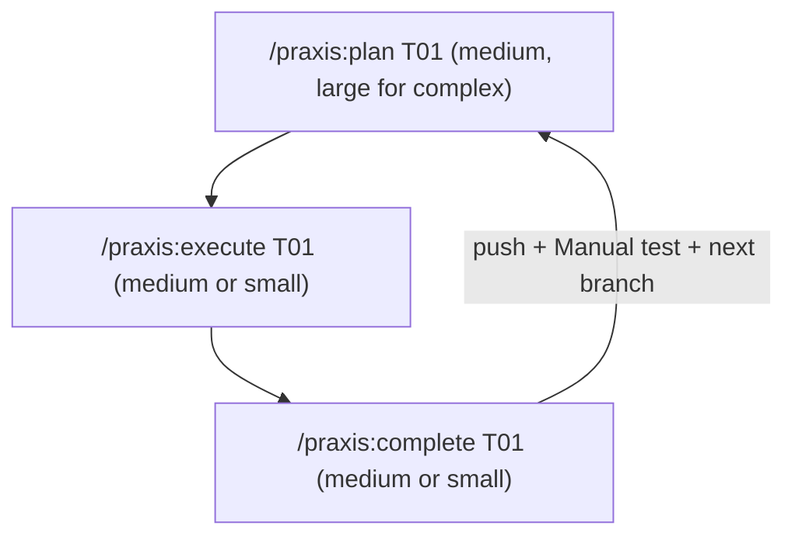

# Praxis <!-- omit in toc -->

## 🧠 Introduction <!-- omit in toc -->

**Praxis** is a drop-in methodology pack for long-horizon software work with
Claude Code.

Two entry points, each preceded by the same grill:

| When                               | Use                                                                                                                            |
| ---------------------------------- | ------------------------------------------------------------------------------------------------------------------------------ |
| **New project** (greenfield)       | [`/praxis:grill-me`](METHODOLOGY.md#-grilling-between-idea-and-planning) → [`/praxis:bootstrap`](METHODOLOGY.md#-two-entry-points) |
| **New feature** (existing project) | [`/praxis:grill-me`](METHODOLOGY.md#-grilling-between-idea-and-planning) → [`/praxis:add-feature`](METHODOLOGY.md#-two-entry-points)         |

`/praxis:grill-me` is the universal first step for any idea — most valuable in
greenfield work, where nothing exists yet and every unspoken assumption is
still on the table.

- **One plugin install** — skills and subagents ship with the plugin; `/praxis:init` adds rules and phase templates to your repo
- **Grill the idea first** — `/praxis:grill-me` interviews you over a design tree until nothing is silently assumed (inspired by [Matt Pocock](https://www.aihero.dev/skills-grill-me))
- **Agent gathers context** — detailed goal, technical scope, constraints (refuses without them)
- **Build in phases** — plan → execute → complete, one verifiable layer at a time
- **Subagents for facts and mechanics** — explorers, reviewers, test runners, and verifiers do the legwork in parallel; the parent keeps design and decisions
- **Evolve as you learn** — dialectic of cognition captures hard-won patterns back into the rules
- **Product-agnostic** — no sample product is bundled; adapts to your stack

> 💡 **For full methodology details, see [`METHODOLOGY.md`](METHODOLOGY.md).**

## Table of Contents <!-- omit in toc -->

- [⚡ Quickstart](#-quickstart)
- [🔁 Running the Work Loop](#-running-the-work-loop)
- [🔌 Claude Code Configuration](#-claude-code-configuration)
- [🛡️ Hard Rules](#️-hard-rules)
- [🌀 Dialectic of Cognition Methodology](#-dialectic-of-cognition-methodology)
  - [📕 Influence: Mao's *On Practice* (1937)](#-influence-maos-on-practice-1937)
  - [🧰 What `/praxis:learn` does (summary)](#-what-praxislearn-does-summary)
- [📂 Files and Directories](#-files-and-directories)
- [🙏 Credits](#-credits)

---

## ⚡ Quickstart

Praxis is a Claude Code plugin — works on Windows, macOS and Linux.

```text
/plugin marketplace add Mussiefekadu/praxis
/plugin install praxis@praxis
```

**For a team:** install with `--scope project` (or pick *project* in `/plugin`).
That writes `.claude/settings.json`; commit it and teammates are offered Praxis
when they open the repo.

Then, inside your project, run `/praxis:init`. It copies the rules hub, phase
templates and seeds into your repo (never overwriting). Skills and subagents
stay in the plugin and update with it.

Every skill ends with a **next-step button** (Claude desktop app) instead of
asking you to type the next command.

Then:

1. `cd` into `YOUR_PROJECT` and run `claude` (💡 use a `large` model, see [Model recommendations](#model-recommendations)), then `/praxis:init`
2. Click **Grill the idea** (or run `/praxis:grill-me`)

   a. This stress-tests the idea in rounds over a design tree — facts via sub-agents, decisions via you — before any planning happens. Most valuable on greenfield work, where nothing is settled yet.

3. Run `/praxis:bootstrap`

   a. 💡 Use a `large` model — this step requires complex reasoning.

   b. The agent will ask for a detailed goal, technical scope, and constraints before building anything.

   c. This is your chance to outline the project's architecture, and high level goals.

   d. ❕ BE THOROUGH; the input here will play a major role in the quality of the output.
4. Once it has completed, review the architecture, layer order, and README the agent produced.
5. You are now ready to run the **work loop** and begin building your project. 💫

### 🛠️ Model recommendations <!-- omit in toc -->

Where "large", "medium", and "small" appear throughout the docs, they refer to:

| Size       | Model             |
| ---------- | ----------------- |
| **Large**  | Claude Opus       |
| **Medium** | Claude Sonnet     |
| **Small**  | Claude Haiku      |

> 💡 **These are recommendations, not hard rules.** Use the best model you have
> access to that fits the task's complexity budget — swap models with `/model`.

## 🔁 Running the Work Loop

Once bootstrap is complete, enter the work loop:



Every idea starts with the same grill: [`/praxis:grill-me`](METHODOLOGY.md#-grilling-between-idea-and-planning)
interrogates it in rounds over a design tree (facts via sub-agents, decisions
via the human) until a shared-understanding summary is confirmed — most
valuable on greenfield work, where nothing is settled yet. Then:

- **New project** → `/praxis:bootstrap`, which turns the settled goal into rules + phases.
- **New feature** → `/praxis:add-feature`, which reads current rules and INDEX plus the
  settled grilling decisions, then proposes new phase stubs without disturbing existing infrastructure.

Plans will be **handoff-ready** for a lesser execute agent (see hub "[Model split](METHODOLOGY.md#model-split)").
Only flag large-model execute when the task is exceptionally hard.

### Model split <!-- omit in toc -->

See [Model recommendations](#model-recommendations) for the specific Claude
model behind each size tier.

| Skill                                   | Recommended model                         |
| --------------------------------------- | ----------------------------------------- |
| `/praxis:grill-me`                             | Large                                     |
| `/praxis:bootstrap` / `/praxis:add-feature` | Large                                     |
| `/praxis:plan`                          | Medium (use large only for complex tasks) |
| `/praxis:execute`                       | Medium or small                           |
| `/praxis:complete`                      | Medium or small                           |

> 💡 **This is a recommendation, not a hard rule.** Use the largest model you have
> access to when the task warrants it; scale down when mechanical execution suffices.

> For full work loop details see [`METHODOLOGY.md#-running-the-loop`](METHODOLOGY.md#-running-the-loop).
> For how skills delegate to subagents see
> [`METHODOLOGY.md` — Subagent delegation](METHODOLOGY.md#4--subagent-delegation).

## 🔌 Claude Code Configuration

This workflow is built for **Claude Code**. After install, a project has:

- **Rules** under `.claude/rules/` — hub is `general.md` (no `paths:` frontmatter, so
  it loads every session); domain spokes sit beside it as `.claude/rules/<domain>.md`
  with `paths:` frontmatter, Claude Code's native mechanism for loading a rule file
  automatically when a matching file is read or edited.
- **Subagents** shipped by the plugin (`praxis:*`) — the delegation roster (`explorer`,
  `web-researcher`, `implementer`, `refactorer`, `test-runner`, `code-reviewer`,
  `verifier`, `doc-writer`) that skills fan work out to via the `Agent` tool.
- **Skills** shipped by the plugin — invocable commands (`/praxis:grill-me`, `/praxis:plan`, `/praxis:execute`, `/praxis:complete`, …).

Combined with the hub's routing map, the evolving `.claude/rules/*.md` files are maintained by `/praxis:learn`.

## 🛡️ Hard Rules

- ❌ **Do not** create rules anywhere but `.claude/rules/`. Skills and subagents ship with the plugin.
- 1️⃣ **One InProgress phase task** at a time unless the human explicitly allows more.
- ✅ **INDEX Status** uses `✅` when complete (not the word `Done` in the INDEX column).
- 🚫 Product **features** are out of scope for bootstrap; bootstrap produces rules +
  phases + skills wiring + dependency spokes from docs + human `README.md` +
  `.gitignore` + **root verify gate** (verify command + lint config + pre-commit hook for your stack; not the app itself).
- 🧪 Execute/complete **fail closed** if verify tooling is missing — unit tests alone are not green.
- 👥 **Rules/skills = agents; README = humans** — both evolve; keep Dependencies & docs
  and architecture narrative aligned with `.claude/rules/` as the project grows.

## 🌀 Dialectic of Cognition Methodology

### 📣 Motto <!-- omit in toc -->

> *From the particular to the general, then from the general to the particular.*

In agent terms:

1. **Particular → general** — A concrete bug or change (symptoms, failed attempts, docs consulted) is abstracted into a **problem class**, not a one-off anecdote.
2. **General → particular** — That class is written into the matching `.md` rule (symptom / cause / fix), so the next session can recognize and act without rediscovering it.
3. **Verify in practice** — A cold read of the new entry must be enough to spot the symptom and apply the fix. If not, refine until practice would confirm it.

Abort gate before encoding: *can you state the rule without naming a specific file, function, class, variable, or endpoint?* If not, there is nothing generalizable to store — the value stays in the diff.

### Guidelines <!-- omit in toc -->

Installed projects do not treat `.claude/rules/` as a frozen style guide.
They treat it as a **living knowledge base** produced by working on the stack —
updated deliberately after hard sessions via `/praxis:learn` (also run
from `/praxis:complete`). Principles live in the hub
[`templates/rules/general.md`](templates/rules/general.md) → Rule Maintenance
(and the project's installed copy); the skill is only the operational harness.

The hub also carries always-on cores that dialectic does **not** replace:

1. 🧭 **Karpathy Behavioral Guidelines** — think / simplicity / surgical / goal-driven  
2. ♻️ **Rule Maintenance** — dialectic of cognition steps 0–7  
3. 🛡️ **Safety / Workflow Rails** — no-gos, verification defaults, commit/push policy  

- `/praxis:execute` and `/praxis:complete` run the project's **verify command** (declared in
  the hub's Verify gate section) and hard-abort if it, its lint config or its pre-commit hook
  is missing. Package tests alone are not the gate.
- `/praxis:complete` **pushes** the completed branch by default (`--no-push` to skip) and always
  emits a **Manual test** section (or `Nothing to test` + why).
- `/praxis:bootstrap` picks a verify gate for your stack — e.g. `make verify` (Go),
  `npm run verify` (Node), `nox -s verify` (Python), `just verify` (Rust) — with a lint config
  and a pre-commit hook, at latest stable toolchain versions, and records it in the hub.
  Go projects start from the bundled seeds (`Makefile` with `lint`, `test`, `build`,
  multi-platform `build-all`, `verify`; `lefthook.yml`; `.golangci.yml`).

See [`METHODOLOGY.md`](METHODOLOGY.md)

### 📕 Influence: Mao's *On Practice* (1937)

The maintenance loop is deliberately patterned on Mao Zedong's Marxist epistemology in **"On Practice: On the Relation Between Knowledge and Practice, Between Knowing and Doing"** (July 1937) — written amid the Yan'an period, when the Chinese Communists were rebuilding strategy from lived struggle rather than importing ready-made formulas. The essay's argument is epistemological, not decorative: knowledge that never returns to practice becomes dogma; practice that never rises to theory stays a pile of anecdotes.

**Primary text:** [marxists.org — Selected Works, Vol. 1, *On Practice*](https://www.marxists.org/reference/archive/mao/selected-works/volume-1/mswv1_16.htm)

**Accessible overview:** [PolSci Institute — *On Practice*: Mao's Epistemology and Theory of Knowledge](https://polsci.institute/political-theory/mao-epistemology-theory-of-knowledge/)

Mapped onto this workflow:

| Idea from *On Practice*                                                                                     | How it shows up here                                                                                           |
| ----------------------------------------------------------------------------------------------------------- | -------------------------------------------------------------------------------------------------------------- |
| Knowledge begins in **practice** (contact with the thing); perceptual → rational                            | Hard debugging, failed attempts, and real code changes are the "perceptual" material — not invented principles |
| Rational knowledge grasps **essence / internal relations**, not isolated incidents                          | Encode a **problem class** (root-cause pattern), discard session-only noise                                    |
| Theory must **return to practice**; practice is the criterion of truth                                      | New rule entries must pass the cold-read check; stale entries decay or get struck                              |
| Oppose **dogmatism** (formulas without practice) and **empiricism** (fragmentary experience without theory) | Don't paste bookish rules that never matched this codebase; don't leave one-off fixes only in chat history     |
| *Practice, knowledge, again practice, and again knowledge* — an ascending spiral                            | Rules improve session by session; `/praxis:learn` is the deliberate turn of that spiral              |

Closing line of the essay (the spiral of cognition):

> Discover the truth through practice, and again through practice verify and develop the truth. … Practice, knowledge, again practice, and again knowledge. This form repeats itself in endless cycles, and with each cycle the content of practice and knowledge rises to a higher level.

That is the philosophical warrant for treating `.claude/rules/` as a **material product of work on a stack** — not a static style guide dropped from outside.

### 🧰 What `/praxis:learn` does (summary)

Authority: Rule Maintenance in the installed `general.md`. Invoke manually after non-trivial sessions; `/praxis:complete` runs it as part of close-out.

- **Mode A** — After qualifying debugging (>5 min, docs consulted, multiple attempts, or non-obvious root cause): extract class → route via the table in `general.md` → encode / verify / integrity checks into **the project's** `.claude/rules/*.md`.
- **Mode B** — After structural code changes: ask whether any encoded pattern is now stale, incomplete, or contradicted; refine or add only what generalizes.
- **Shared** — Prefer refining overlapping entries over proliferating duplicates; propose a human-approved split if a rule file exceeds ~600 lines (earlier if approaching ~550); timestamp `<!-- last-verified: YYYY-MM -->`; review entries older than six months when working in that domain.

If Modes A/B find nothing: *"Nothing to capture — session was routine."*

## 📂 Files and Directories

```
.
├── .claude-plugin/ ............... 🔌 plugin.json + marketplace.json
├── skills/ ....................... 🧩 /praxis:* skills (init, grill-me, bootstrap, plan, execute, complete, …)
├── agents/ ....................... 🤖 Subagent roster
├── METHODOLOGY.md ................ 🧠 Why this works; entry points; work loop
├── templates/
│   ├── seeds/ .................... 🌱 readme · gitignore · verify (Go example: Makefile / lefthook / golangci)
│   ├── rules/ .................... 📜 Generic `general.md` + example domain spoke
│   └── phases/ ................... 🗂️ INDEX.md skeleton + TXX-template.md
```

## 🙏 Credits

Praxis is based on [Turboplan](https://github.com/commoddity/turboplan) by
[commoddity](https://github.com/commoddity), used under the MIT License.
