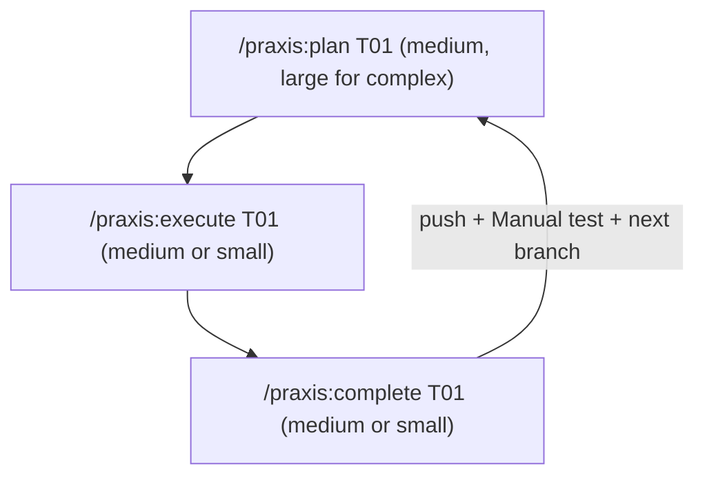

# Praxis <!-- omit in toc -->

**Praxis** is a Claude Code plugin for long-horizon software work. It grills
your idea until nothing is assumed, turns it into rules and layered phases,
then builds one verifiable task at a time: a large model plans, a cheaper one
executes, and subagents do the legwork. Every skill ends with a **next-step
button**, so you click through the loop instead of typing commands.

- [⚡ Install](#-install)
- [🚀 First 10 minutes](#-first-10-minutes)
- [🔁 The work loop](#-the-work-loop)
- [🧩 Skills](#-skills)
- [🛡️ Hard rules](#️-hard-rules)
- [🌀 Why it works](#-why-it-works)
- [📂 Files and directories](#-files-and-directories)
- [🙏 Credits](#-credits)

## ⚡ Install

Works on Windows, macOS and Linux. In Claude Code:

```text
/plugin marketplace add Mussiefekadu/praxis
/plugin install praxis@praxis
```

**For a team:** install with `--scope project` (or pick *project* in `/plugin`).
That writes `.claude/settings.json`; commit it and teammates are offered Praxis
when they open the repo.

## 🚀 First 10 minutes

1. Open your project in Claude Code and run **`/praxis:init`**. It copies the
   rules hub, phase templates and seeds into the repo — never overwriting.
2. Click **Grill the idea** (`/praxis:grill-me`). It interviews you over a
   design tree — facts via subagents, decisions via you — until you confirm a
   shared-understanding summary.
3. Click **Confirm → bootstrap** (`/praxis:bootstrap`). It writes the rules,
   phase INDEX, task stubs, README, `.gitignore` and a verify gate for your
   stack. ❕ Be thorough here: goal, stack, non-goals and constraints shape
   everything after.
4. Review the architecture, layer order and README it produced.
5. Click **Plan T01** and you're in the work loop.

Already have a project? Use `/praxis:add-feature` instead of bootstrap in step 3.

## 🔁 The work loop



- **Plan** writes a handoff-ready plan, then a fresh `plan-reviewer` subagent
  reads it cold and flags anything a smaller model would have to guess.
- **Execute** follows it until the acceptance criteria pass and the verify
  command is green.
- **Complete** re-verifies, captures learnings into the rules, marks the task
  ✅, commits, pushes and hands you a manual test.

Coming back after a break? Run `/praxis:status` (or just ask "where was I?").
It reports what's done, in progress or blocked, checks your branch, and offers
the next command as a button.

## 🧩 Skills

| Skill | When | Model |
| ----- | ---- | ----- |
| `/praxis:init` | Once per project — installs rules, phase templates, seeds | Any |
| `/praxis:grill-me` | Before any new project or feature | Large |
| `/praxis:bootstrap` | New project: goal → rules + phases + verify gate | Large |
| `/praxis:add-feature` | New feature in an existing project → new phase stubs | Large |
| `/praxis:plan TXX` | Before coding a task | Medium (large if complex) |
| `/praxis:execute TXX` | After plan | Medium or small |
| `/praxis:complete TXX` | After execute | Medium or small |
| `/praxis:status` | Returning to a project | Small |
| `/praxis:learn` | After a hard session (also run by complete) | Any |
| `/praxis:audit-rules` | Periodically — read-only rules audit | Any |

Large / medium / small = Claude Opus / Sonnet / Haiku. These are
recommendations — swap with `/model` to fit the task.

Skills delegate to the plugin's subagents (`praxis:explorer`, `web-researcher`,
`implementer`, `refactorer`, `test-runner`, `code-reviewer`, `verifier`,
`plan-reviewer`, `doc-writer`); the parent keeps design and decisions. See
[Subagent delegation](METHODOLOGY.md#4--subagent-delegation).

## 🛡️ Hard rules

- 1️⃣ **One InProgress task** at a time unless you explicitly allow more.
- 🧪 **Fail closed on verify.** Execute and complete run the verify command
  declared in the hub's Verify gate section (e.g. `make verify`, `npm run verify`,
  `nox -s verify`) and stop if it, its lint config or its pre-commit hook is
  missing. Unit tests alone are not green.
- 🚫 **Bootstrap builds no features** — only rules, phases, dependency spokes,
  README, `.gitignore` and the verify gate.
- 📜 **Rules live only in `.claude/rules/`**; skills and subagents ship with the plugin.
- ✅ INDEX Status uses `✅` when complete, never the word `Done`.
- 🚀 `/praxis:complete` pushes by default (`--no-push` to skip) and always ends
  with a Manual test section.
- 👥 **Rules = agents, README = humans** — keep both in sync as the project grows.

## 🌀 Why it works

Praxis treats `.claude/rules/` as a **living knowledge base**, not a frozen
style guide. After hard sessions, `/praxis:learn` turns a concrete bug into a
*problem class* and encodes it as symptom / cause / fix, so the next session
recognizes it cold:

> *From the particular to the general, then from the general to the particular.*

The loop is patterned on Mao Zedong's *On Practice* (1937) — practice,
knowledge, again practice. The full method, its philosophy and the rule
maintenance procedure are in [`METHODOLOGY.md`](METHODOLOGY.md).

## 📂 Files and directories

```
.
├── .claude-plugin/ ............... 🔌 plugin.json + marketplace.json
├── skills/ ....................... 🧩 /praxis:* skills
├── agents/ ....................... 🤖 Subagent roster
├── METHODOLOGY.md ................ 🧠 Why this works; entry points; work loop
├── CHANGELOG.md .................. 📝 What changed in each version
├── templates/ .................... copied into your project by /praxis:init
│   ├── rules/ .................... 📜 Hub `general.md` + example domain spoke
│   ├── phases/ ................... 🗂️ INDEX.md skeleton + task template
│   └── seeds/ .................... 🌱 README · .gitignore · verify (Go example)
```

After `/praxis:init` and bootstrap, your project has `.claude/rules/` (the hub
loads every session; domain spokes load via `paths:` frontmatter when matching
files are touched) and `planning/phases/` (the INDEX plus one file per task).

## 🙏 Credits

Praxis is based on [Turboplan](https://github.com/commoddity/turboplan) by
[commoddity](https://github.com/commoddity), used under the MIT License.
`/praxis:grill-me` is inspired by [Matt Pocock](https://www.aihero.dev/skills-grill-me).
